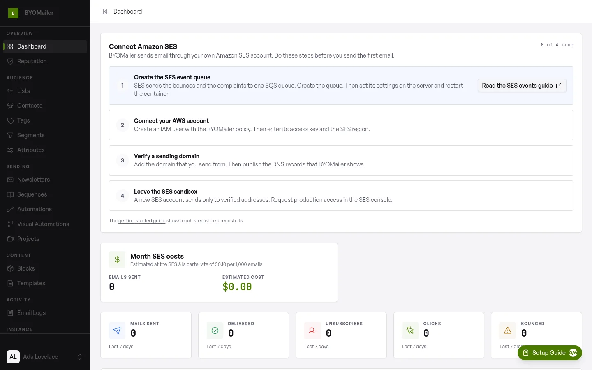
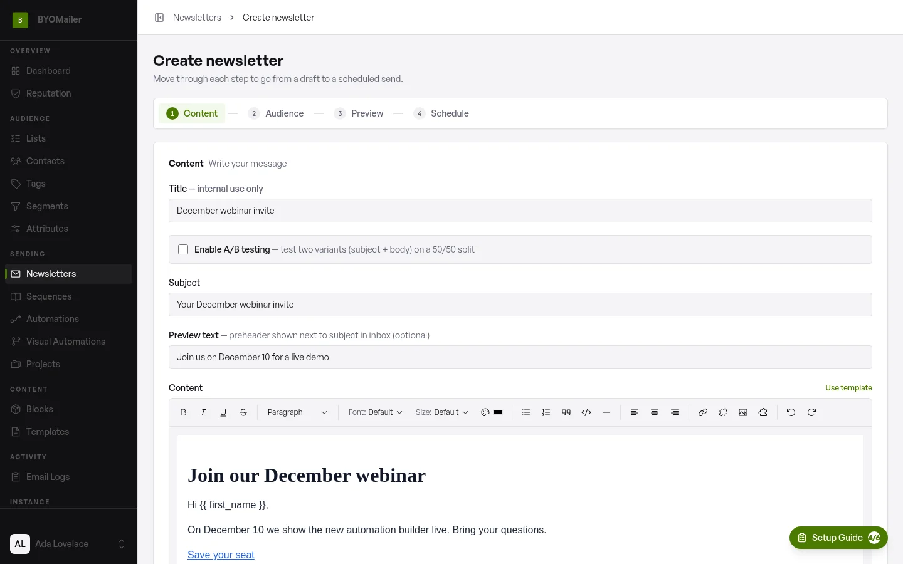
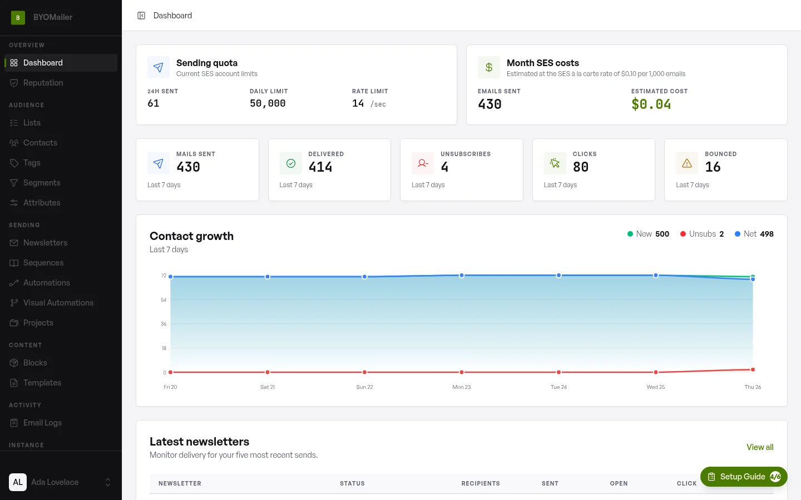
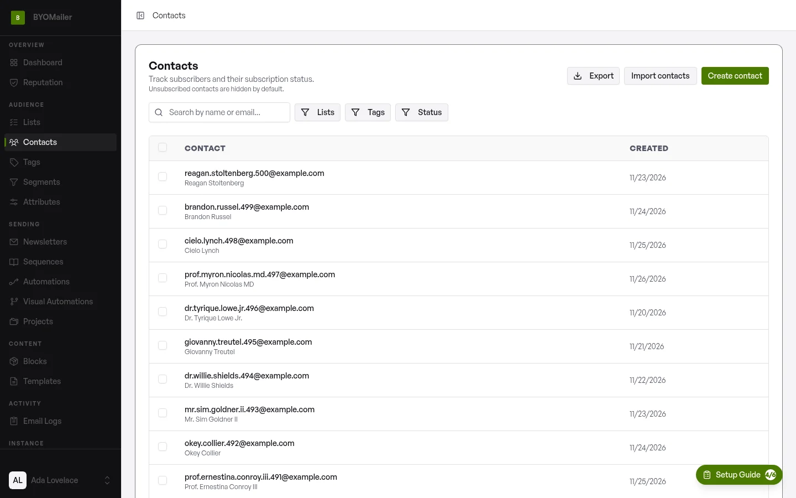

# BYOMailer

[](https://github.com/amedina068/byomailer/actions/workflows/ci.yml)
[](https://scorecard.dev/viewer/?uri=github.com/amedina068/byomailer)

A self-hosted email marketing app that sends through your own Amazon SES account. You keep your contacts, your sending reputation and your AWS bill. BYOMailer adds the lists, the editor, the campaigns and the tracking on top of SES.

```bash
docker run -d --name byomailer -p 8080:8080 -v byomailer:/data ghcr.io/amedina068/byomailer
docker logs -f byomailer
# Open the setup URL on the last line of the log.
```

You need no `.env` file, no keys and no database server. The setup page creates the owner account. Then the dashboard shows the Amazon SES steps: create the SES event queue, connect your AWS account, verify a sending domain and leave the SES sandbox.

| The first login | A newsletter |
|---|---|
|  |  |
| **The dashboard** | **Contacts** |
|  |  |

BYOMailer is a Laravel 13 app with an Inertia and Vue 3 dashboard.

## Features

- **Newsletters.** Write in a block editor, select the audience with filters or saved segments, then send now or schedule. Do A/B tests on the subject or the content.
- **Sequences.** Drip campaigns with a delay between the steps. Each step can have its own audience filters.
- **Automations.** Start actions when a contact joins a list, gets a tag, finishes a sequence or has an attribute change. A visual builder is also available.
- **Contacts.** Lists, topics, tags and custom attributes. CSV import and export. Each contact has a preference center and a one-click unsubscribe link (RFC 8058).
- **Templates and blocks.** Reusable email templates and content blocks with `{{ variable }}` placeholders.
- **Deliverability.** BYOMailer records the deliveries, bounces, complaints, opens and clicks from SES. It suppresses the addresses that bounced or complained. A reputation page shows the rates that AWS monitors.
- **Custom domains.** Custom tracking domains and custom link domains for each sending identity.
- **Teams.** Invite users with the admin, editor or viewer role. Two-factor authentication is available.
- **API, webhooks and MCP.** A REST API (`/api/v1`) with an [OpenAPI document](docs/api/openapi.yaml), outgoing webhooks, and an MCP server (`/mcp`) for Claude, Codex, Cursor and other agents.
- **Compliance warnings.** The editor warns when a campaign has no unsubscribe link or no postal address. BYOMailer adds the one-click `List-Unsubscribe` header to each campaign email.

## Run in production

Point a DNS A record for your domain, for example `mail.example.com`, to the server. Then run the installer on the server:

```bash
curl -fsSL https://raw.githubusercontent.com/amedina068/byomailer/main/install.sh | bash
```

The installer asks for one value, the domain. It checks Docker and the ports, starts the container, waits for the health check and shows the setup URL. Add `--dry-run` to see the commands first.

To start the container yourself, set `APP_DOMAIN` and publish ports 80 and 443:

```bash
docker run -d --name byomailer --restart unless-stopped \
  -p 80:80 -p 443:443 -p 443:443/udp \
  -e APP_DOMAIN=mail.example.com \
  -v byomailer:/data \
  ghcr.io/amedina068/byomailer
```

HTTPS is automatic. Caddy gets the certificate on the first request. Open and click tracking and the unsubscribe links need HTTPS. `APP_DOMAIN` is the only required variable. The app derives the URL, the cookie settings and the trusted hosts from it.

To put the app behind your own proxy, set `CADDY_ENABLED=false` and send the traffic to port 8080. To send the invitations and the password resets, set the `MAIL_*` variables. Read [Reverse proxy and TLS](https://byomailer.com/docs/self-hosting/reverse-proxy-and-tls) and [Configuration](https://byomailer.com/docs/getting-started/configuration).

A version tag (`v0.1.0` and later) publishes the image for `linux/amd64` and `linux/arm64`. Before the first tag, build the image from a clone: `docker build -t ghcr.io/amedina068/byomailer .`

## Install with an AI agent

Paste this prompt into Claude Code, Codex or another agent that has a shell on the server:

```text
Read https://raw.githubusercontent.com/amedina068/byomailer/main/INSTALL.md and install BYOMailer on this server.
```

The agent installs the app, creates the owner and makes an API token. Its last step gives you two lines that connect your agent to the MCP server of the instance. The first line exports the token. The second line reads the token from that variable, so the token is not in the command:

```bash
export BYOMAILER_TOKEN='<token>'
claude mcp add --transport http byomailer https://mail.example.com/mcp \
  --header "Authorization: Bearer ${BYOMAILER_TOKEN}"
```

To show the lines again, run `docker exec byomailer php artisan byomailer:mcp:connect --client=claude`. The client can also be `codex`, `cursor` or `json`.

A second MCP server operates the instance itself: status, doctor, users, tokens, the queue and the SES status. It runs over SSH, with no open port:

```bash
claude mcp add byomailer-admin -- ssh my-server docker exec -i byomailer php artisan mcp:start byomailer-admin
```

## MySQL and Redis

The default database is SQLite in the `/data` volume, and the default queue is the database queue. This is enough for one server. The Compose file has a `mysql` profile that adds MySQL 8.4 and Redis. In this mode, the queue runs on Horizon.

```bash
git clone https://github.com/amedina068/byomailer.git
cd byomailer
cp .env.example .env
```

In `.env`, set `APP_DOMAIN`. Remove the `#` from the lines of the "MySQL and Redis" block, and set `DB_PASSWORD` to a new value from `openssl rand -hex 24`. The block sets `COMPOSE_PROFILES=mysql`, so Compose also starts MySQL and Redis. Then start the stack:

```bash
docker compose up -d --build
docker compose logs -f web
```

The Compose stack listens on `127.0.0.1:8080` and does not start Caddy. Put a reverse proxy with TLS on the host in front of it.

Read [Install with Docker](https://byomailer.com/docs/getting-started/installation-docker) for each service and each volume, and [Manual installation](https://byomailer.com/docs/getting-started/installation-manual) for a server without Docker.

## Amazon SES setup

BYOMailer sends email only through Amazon SES. After the first login, the dashboard shows the SES steps in this order.

**1. Create the SES event queue (one time, by the owner).** SES sends the bounces, complaints, opens and clicks back through one SQS queue for the whole instance. The AWS connection of each account subscribes to this queue, so it fails without the queue. Create the queue as [SES events](https://byomailer.com/docs/self-hosting/ses-events) describes. Then give its settings to the container:

```bash
docker run -d --name byomailer ... \
  -e PLATFORM_AWS_ACCESS_KEY_ID=<key id> \
  -e PLATFORM_AWS_SECRET_ACCESS_KEY=<secret> \
  -e PLATFORM_AWS_REGION=us-east-1 \
  -e SES_EVENTS_SQS_QUEUE_URL=https://sqs.us-east-1.amazonaws.com/<account>/byomailer-ses-events \
  -e SES_EVENTS_SQS_QUEUE_ARN=arn:aws:sqs:us-east-1:<account>:byomailer-ses-events \
  ghcr.io/amedina068/byomailer
```

The installer accepts the same variables in a file: `install.sh --env-file=/root/byomailer.env`. When `PLATFORM_AWS_ACCESS_KEY_ID`, `PLATFORM_AWS_SECRET_ACCESS_KEY` and `SES_EVENTS_SQS_QUEUE_URL` are set, the container starts the `ses-events:poll` worker. Without them, the worker does not start. The AWS connection of each account also needs `SES_EVENTS_SQS_QUEUE_ARN`.

**2. Connect each AWS account.** Each account in BYOMailer connects its own AWS account:

1. Create an IAM user with the policy that the AWS connection page shows. Then enter its access key and the SES region.
2. Add a sending domain. Publish the DNS records that BYOMailer shows.
3. If the SES account is in the sandbox, request production access in the SES console.

The guides in the app, at `/documentation/guides/getting-started`, show each step with screenshots. Read [Connect AWS SES](https://byomailer.com/docs/getting-started/connect-aws-ses) for the details.

> [!WARNING]
> If the `ses-events:poll` worker does not run, BYOMailer does not see the bounces and the complaints. It continues to send to the addresses that SES rejects, and AWS can pause your SES account. `byomailer:doctor` reports a missing queue.

## Upgrade

Run the installer again. Or pull the image and start a new container with the same volume:

```bash
docker pull ghcr.io/amedina068/byomailer
docker rm -f byomailer
docker run -d --name byomailer ...   # the same command as before
```

The container runs the new migrations when it starts.

> [!IMPORTANT]
> **Compose installs from before the one-container image.** The old stack had separate `horizon` and `scheduler` services, and MySQL started without a profile. Before the first `docker compose up` with the new files, do these steps one time:
>
> 1. In `.env`, add `COMPOSE_PROFILES=mysql` and the lines of the "MySQL and Redis" block of `.env.example`. Keep your `DB_PASSWORD`.
> 2. Run `docker compose up -d --build --remove-orphans`. This removes the old `horizon` and `scheduler` containers. The `web` container now runs Horizon and the scheduler.
>
> The old Compose file set `DB_CONNECTION=mysql` itself. The new file does not. Without the MySQL block, the app starts on a new, empty SQLite database, and your MySQL data stays unused.

Read the [release notes](https://byomailer.com/docs/getting-started/release-notes) and the [changelog](CHANGELOG.md) before you upgrade.

## Backup

The `/data` volume holds all the data: the SQLite database, the uploads and the generated secrets.

```bash
docker stop byomailer
docker run --rm -v byomailer:/data -v "$PWD":/backup alpine \
  tar czf /backup/byomailer-$(date +%F).tar.gz -C /data .
docker start byomailer
```

> [!CAUTION]
> Do not lose the `/data` volume. It holds `APP_KEY`. BYOMailer encrypts the AWS keys of each account with `APP_KEY`. Without it, every account must enter its AWS keys again, and all sessions and setup links stop working.

With MySQL, also back up the database with `mysqldump`. Read [Backups](https://byomailer.com/docs/self-hosting/backups).

## Operate

Each command accepts `--json` for scripts and agents.

| Command | What it does |
|---|---|
| `byomailer:status` | Shows the version, the database, the queue, the scheduler, the mail driver and the SES status. |
| `byomailer:doctor` | Finds problems and gives the fix for each, also for SES and SQS. `--fix` applies the safe fixes. |
| `byomailer:install` | Creates the owner. Returns a one-time login link. `--with-token` also makes an API token. |
| `byomailer:token:create` | Makes an API token. `byomailer:token:list` and `byomailer:token:revoke` manage the tokens. |
| `byomailer:setup-url` | Shows the setup URL again. |
| `byomailer:user:list` | Lists the users. |
| `byomailer:user:password` | Sets a new password for a user. |
| `byomailer:mcp:connect` | Prints the line that connects an AI agent. |

Run a command in the container: `docker exec byomailer php artisan byomailer:doctor`.

## Documentation

The documentation is at [byomailer.com/docs](https://byomailer.com/docs). The source is the [`byomailer-docs`](https://github.com/amedina068/byomailer-docs) repository.

- [Configuration](https://byomailer.com/docs/getting-started/configuration): all the environment variables.
- [Reverse proxy and TLS](https://byomailer.com/docs/self-hosting/reverse-proxy-and-tls): Cloudflare, NGINX, Traefik and `TRUSTED_PROXIES`.
- [Accounts and registration](https://byomailer.com/docs/self-hosting/accounts-and-registration): the owner, the registration modes, and how to deactivate a user.
- [Recover access](https://byomailer.com/docs/self-hosting/recover-access): a new password without mail.
- [Optional integrations](https://byomailer.com/docs/self-hosting/optional-integrations): GeoIP, Rollbar, Cloudflare for SaaS and the tracking proxy.
- [REST API](https://byomailer.com/docs/api/overview) and [MCP server](https://byomailer.com/docs/mcp/overview).
- [ARCHITECTURE.md](ARCHITECTURE.md): how the code works. [DESIGN_SYSTEM.md](DESIGN_SYSTEM.md): the look of the dashboard.

## Contributing

You need PHP 8.4, Composer, Node 24 and SQLite.

```bash
composer install && npm install
cp .env.example .env && php artisan key:generate
touch database/database.sqlite && php artisan migrate
npm run build && php artisan serve
```

Then run `php artisan byomailer:setup-url` and open the URL. Run the tests with `php artisan test` and the JavaScript tests with `npm run test`. Read [CONTRIBUTING.md](CONTRIBUTING.md) before you open a pull request.

Report a security problem in private, as [SECURITY.md](SECURITY.md) describes. One person maintains this project, so answers are not immediate.

## License

BYOMailer is free software under the [GNU Affero General Public License version 3](LICENSE) (AGPL-3.0). If you change the code and let other people use your changed copy over a network, you must offer them the source code of your changed copy.
